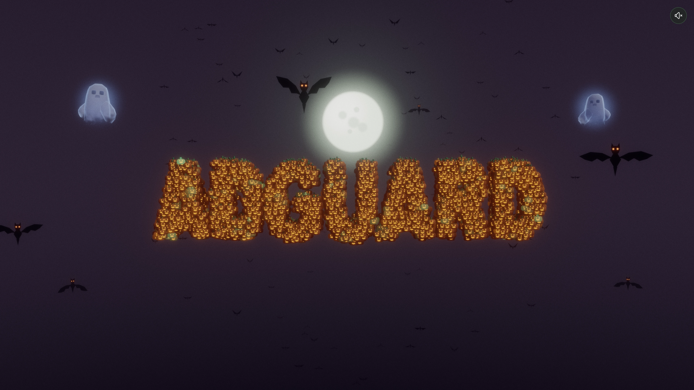

# Halloween AdGuard

An interactive 3D scene that wishes AdGuard users a happy Halloween.



## Description

A browser-based 3D scene created as an AdGuard Halloween greeting.
Pumpkin particles form the AdGuard word under a moonlit sky while bats
and ghosts move through the scene. The scene reacts to the pointer. The
scene uses Three.js with WebGPU and TSL shaders. Vite builds the site.

## Getting Started

Live scene: https://pritulaziah.github.io/halloween-particles-adguard/

To run it locally:

```bash
npm install
npm run dev
```

Open the local URL printed by Vite.

Other commands: `npm test`, `npm run build`, `npm run preview`.

## Usage

Move the pointer across the scene to disturb the pumpkin particles,
scatter the bats, and make the ghosts react. Use the music toggle in the
top-right corner to turn the soundtrack on or off.

Add the `quality` URL parameter to set the detail level: `?quality=high`
or `?quality=low`. A phone or a tablet selects the low level by default.

## Credits

The graveyard models come from the Kenney Graveyard Kit, released under
CC0. See `public/models/LICENSE-kenney.txt`.

## License

MIT. See [LICENSE.md](LICENSE.md).
